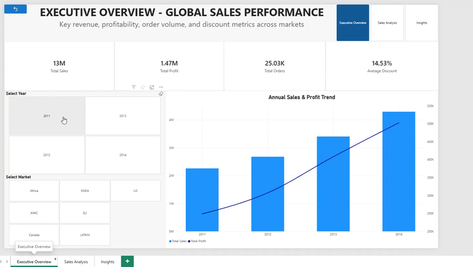
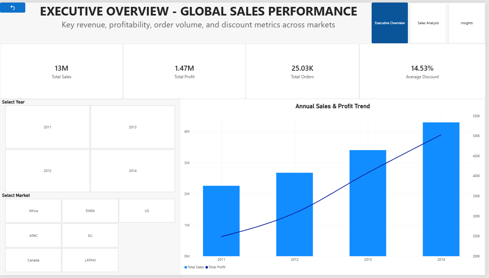
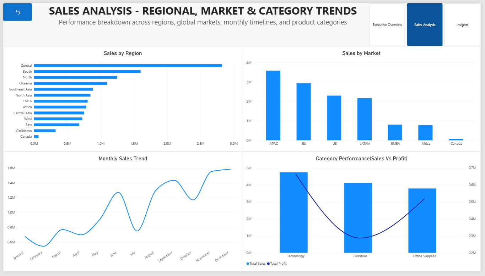
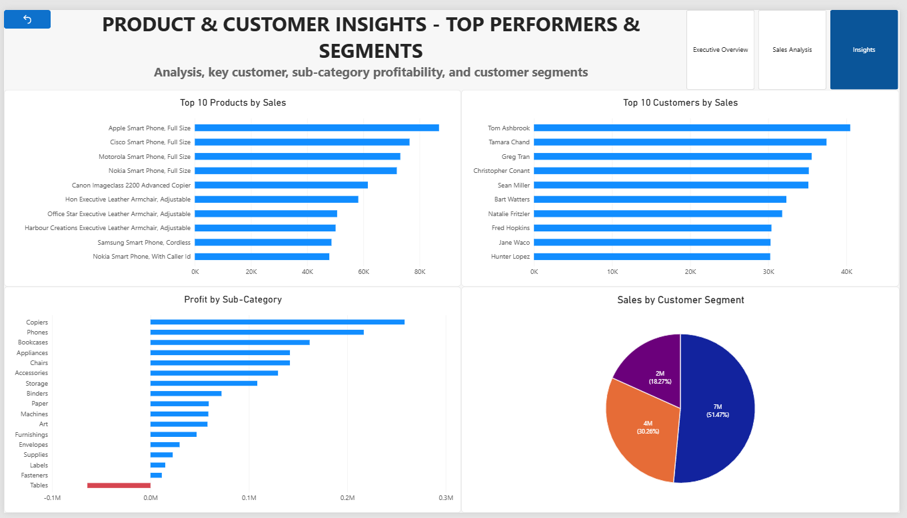

# Global Superstore Sales & Profitability Analysis (SQL, Excel & Power BI)




## 📌 Project Overview
An end-to-end retail data analytics project analyzing **\$13.00M in global sales** and **\$1.47M in total profit** across **25.03K orders**. Using **SQL**, **Microsoft Excel**, and **Power BI**, this project uncovers regional revenue trends, customer segment performance, and product-level profitability bottlenecks to drive actionable business recommendations.

---

## 🛠️ Tools & Technologies Used
* **SQL:** Data exploration, aggregation, regional/category breakdowns, and customer ranking queries.
* **Microsoft Excel:** Data cleaning, duplicate removal, standardization, pivot tables, and exploratory analysis.
* **Power BI:** Data modeling, custom DAX measures, synced slicers, conditional formatting, bookmarks, and interactive 3-page dashboard design.

---

## 📊 Key Business Metrics (KPIs)

| Metric | Value |
| :--- | :--- |
| **Total Sales** | \$13.00M |
| **Total Profit** | \$1.47M |
| **Total Orders** | 25.03K |
| **Average Discount** | 14.53% |

---

## 📈 Dashboard Architecture & Key Insights

### 1. Executive Overview
* High-level KPI cards tracking **Total Sales**, **Total Profit**, **Total Orders**, and **Average Discount**.
* Interactive **Year** (`2011–2014`) and **Market** slicers synced across all report pages, paired with a **1-click Reset Filters** bookmark button.
* Annual revenue and profit trajectory showing consistent year-over-year growth.

### 2. Sales Analysis
* **Regional & Market Performance:** Breakdown of revenue across global markets (APAC, EU, US, LATAM, etc.) and sub-regions.
* **Monthly Sales Trend:** Identifies strong seasonal spikes during Q4 (November–December).
* **Category Performance:** Compares revenue vs. profit across **Technology**, **Office Supplies**, and **Furniture**—highlighting that while Furniture generates strong revenue, high discounting compresses its profit margins.

### 3. Product & Customer Insights
* **Top 10 Products & Customers:** Ranks the highest-revenue SKUs and key accounts using dynamic Top-N filtering.
* **Profit by Sub-Category:** Conditional formatting highlights **Tables** in red as the primary loss-making sub-category (`-$0.1M` range), whereas **Copiers**, **Phones**, and **Bookcases** lead profitability.
* **Customer Segment Analysis:** Evaluates revenue share across **Consumer**, **Corporate**, and **Home Office** segments.

---

## 🖼️ Dashboard Previews

* **Page 1 — Executive Overview:** 
* **Page 2 — Sales Analysis:** 
* **Page 3 — Product & Customer Insights:** 

---

## 📂 Repository Structure
```text
├── Level_1/        # Data cleaning & Excel exploratory analysis
├── Level_2/        # SQL queries & analytical scripts (with dedicated README)
├── Level_3/        # Interactive 3-page Power BI dashboard (with dedicated README)
├── Resources/      # Raw datasets, dashboard previews & demo GIF
└── README.md       # Main project overview
```
---

## 💡 Strategic Recommendations
1. **Optimize Discounting on Furniture & Tables:** Audit discount thresholds on **Tables** (currently operating at a net loss) and cap aggressive discounting to restore positive profit margins.
2. **Scale High-Margin Categories:** Increase inventory and promotional focus on **Technology** (especially **Copiers** and **Phones**), which deliver the strongest profit-to-sales ratios.
3. **Capitalize on Q4 Peak Demand:** Align marketing spend and supply chain capacity ahead of the Q4 seasonal surge across top-performing markets (**APAC** and **EU**).

---

## ✅ Conclusion
This end-to-end analytics project demonstrates how raw retail data can be transformed into actionable executive intelligence using **Excel**, **SQL**, and **Power BI**. By tracking **$13.00M in sales** and **$1.47M in profit** across global markets, the analysis pinpoints **Technology** (specifically **Copiers** and **Phones**) and Q4 seasonal demand as primary growth engines, while identifying excessive discounting on **Tables** as the key driver of margin erosion. Together, the SQL scripts and interactive 3-page Power BI dashboard provide leadership with a repeatable, self-service decision-making tool.