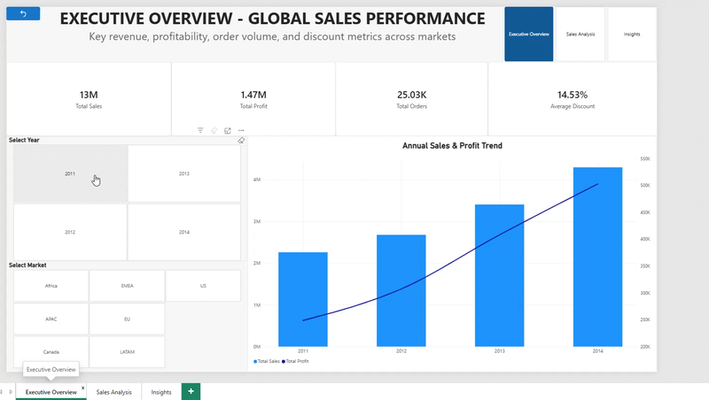

# Global Superstore Sales & Profitability Analysis (Excel, SQL & Power BI)

## 📌 Project Overview
An end-to-end retail data analytics internship project analyzing **$13.00M in global sales** and **$1.47M in total profit** across **25.03K orders** (`2011–2014`). Using **Microsoft Excel**, **PostgreSQL**, and **Power BI**, this repository tracks the complete data lifecycle from raw data cleaning to executive visualization.

---

## 🗂️ Project Modules & Direct Links

* 📊 **[Level 1: Data Cleaning & Excel Exploratory Analysis](./Level_1/)** — Raw dataset standardization, duplicate removal, and pivot table exploration.
* 🗄️ **[Level 2: SQL Exploratory Data Analysis (PostgreSQL)](./Level_2/)** — 10 analytical SQL queries covering market revenue, customer rankings, shipping modes, and loss-making orders.
* 📈 **[Level 3: Interactive 3-Page Power BI Dashboard](./Level_3/)** — Executive Overview, Sales Analysis, and Product & Customer Insights with synced slicers, DAX measures, and bookmarks.
* 📁 **[Resources](./Resources/)** — Source datasets, dashboard previews, and demo visuals.

---

## 📊 Executive KPIs at a Glance

| Metric | Value |
| :--- | :--- |
| **Total Sales** | $13.00M |
| **Total Profit** | $1.47M |
| **Total Orders** | 25.03K |
| **Average Discount** | 14.53% |